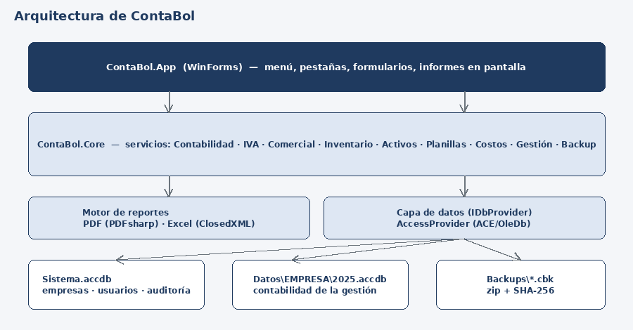
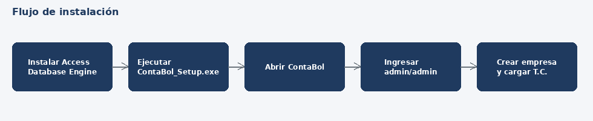

## 1. Arquitectura




| Proyecto | Contenido |
|---|---|
| `ContaBol.Core` | Datos (Access/ACE), esquema, servicios contables/comerciales, reportes PDF/Excel. Sin dependencias de interfaz. |
| `ContaBol.App` | Aplicación WinForms (net8.0-windows). |
| `ContaBol.Tests` | 57 pruebas automáticas (SQLite en memoria). |

**Datos**: `Sistema.accdb` (empresas, usuarios, gestiones, auditoría) + un archivo por empresa y gestión: `Datos\<EMPRESA>\<AÑO>.accdb`. Cada archivo admite hasta 2 GB; al abrir gestión nueva se parte de un archivo limpio.

## 2. Requisitos
- Windows 10/11 (64 bits recomendado), 4 GB RAM, 500 MB libres + espacio para datos y respaldos.
- **Microsoft Access Database Engine** (ACE 2016 o superior). La edición (x64/x86) debe coincidir con la publicada. No requiere Access instalado.
- Para compilar: SDK .NET 8 (Linux/Windows). La interfaz solo ejecuta en Windows.

## 3. Instalador (recomendado)
Se genera con **Inno Setup 6** (script `instalador/ContaBol.iss`):
```
crear_instalador.bat x64      (o x86)
```
Produce `instalador\salida\ContaBol_Setup_x64.exe`: instala en *Archivos de programa*, crea accesos directos, detecta si falta Access Database Engine y registra el desinstalador.
En GitHub, el flujo `.github/workflows/instalador.yml` compila, ejecuta las 57 pruebas y construye ambos instaladores automáticamente en cada push (descargables en *Actions > Artifacts*); al crear una etiqueta `v1.0.0` los publica en *Releases*.



## 3.1 Compilación manual y publicación
```
cd ContaBol
dotnet test ContaBol.Tests          # 57 pruebas deben pasar
publicar.bat x64                    # o x86 si su Office/ACE es de 32 bits
```
Resultado: `publicar\win-x64\ContaBol.exe` (autocontenido, no requiere instalar .NET). Copie la carpeta completa al equipo destino (ej. `C:\ContaBol`).

## 4. Instalación en el equipo
0. **Con instalador:** ejecute `ContaBol_Setup_x64.exe` (o x86), siga el asistente y abra ContaBol desde el escritorio. Los pasos siguientes aplican a la instalación manual (carpeta publicada).
1. Instale Access Database Engine con la misma arquitectura que la aplicación. Si hay Office de 32 bits y necesita ACE de 64, instale con `AccessDatabaseEngine_X64.exe /quiet`.
2. Copie la carpeta publicada. Cree un acceso directo a `ContaBol.exe`.
3. Al primer arranque se crea la carpeta de datos (por defecto en el perfil del usuario; se muestra en *Ayuda > Acerca de*). Para red, configure una carpeta compartida en `AppSettings` (ruta de datos) con permiso de lectura/escritura para todos los usuarios.
4. Ingrese con `admin` / `admin` y cambie la clave (se exige).

## 5. Despliegue en red (varios usuarios)
- Ubicar la carpeta de datos en un servidor de archivos compartido (UNC `\\servidor\ContaBol\Datos`).
- Access soporta pocos usuarios concurrentes (recomendado ≤ 10). Evite WiFi inestable: puede corromper el `.accdb`.
- Para mayor concurrencia o volumen, el diseño usa `IDbProvider`: se puede añadir un proveedor SQL Server sin cambiar los servicios.

## 6. Puesta en marcha de una empresa
1. **Archivo > Cambiar de empresa o gestión > Nueva empresa**: razón social, NIT, año, moneda. Se carga el plan de cuentas boliviano base y los parámetros.
2. **Contabilidad > Tipos de cambio y UFV**: cargue T.C. oficial y UFV (al menos al inicio de gestión).
3. **Administración > Parámetros**: verifique cuentas contables asociadas (caja, ventas, IVA débito/crédito, IT, costo de ventas, etc.), y en planillas: salario mínimo nacional, tasas AFP.
4. **Administración > Usuarios y permisos**: cree usuarios, asigne rol (administrador, contador, operador, consulta) y empresas.
5. Cargue saldos iniciales: asiento de apertura (comprobante de traspaso), stock inicial (*Inventarios > Ajustes, traspasos y stock inicial*), clientes/proveedores con saldos.
6. Migración desde Orion4 (opcional): *Administración > Importar desde Orion4*, seleccione la carpeta de la gestión (con PRU.MDB, ORION.MDB, INVENT.MDB). Se crea una empresa nueva; revise los avisos.

## 7. Respaldos y recuperación
- **Administración > Copias de seguridad**: genera `.cbk` (zip con manifiesto SHA-256) de la empresa/gestión o de todo. Al salir de la aplicación se hace un respaldo automático.
- Restaurar: seleccione el `.cbk`; se verifica la integridad antes de reemplazar. Haga respaldo previo.
- Política sugerida: diario a otra unidad, semanal fuera del local, mensual archivado (gestión cerrada).
- *Utilitarios > Compactar base de datos* mensualmente (reduce tamaño y repara).

## 8. Mantenimiento y soporte
- *Utilitarios > Verificación*: comprobantes descuadrados, balance, cuentas faltantes, T.C./UFV, stock negativo, tamaño del archivo (alerta cerca de 2 GB).
- Auditoría: *Administración > Auditoría* registra usuario, fecha y acción.
- Cierre anual: ajuste por inflación → diferencia de cambio → asiento de cierre → **Cerrar gestión** → **Abrir nueva gestión** (traslada saldos, existencias, cuentas corrientes y activos).

## 9. Seguridad
Claves con PBKDF2; permisos por opción y empresa; gestión cerrada es de solo lectura. Restrinja la carpeta de datos con permisos NTFS y cifre los respaldos externos.

## 10. Limitaciones conocidas
- El proveedor Access/ACE y la interfaz no fueron ejecutados en el entorno de desarrollo (sin Windows); realice las pruebas del *Manual de pruebas* antes de producción.
- Parámetros legales de planillas y alícuotas deben validarse con la norma vigente.
- La importación de Orion4 no migra movimientos de inventario.
