# 1. Introducción

## 1.1 Objetivo
Verificar, en un equipo Windows real, que ContaBol instala, abre, registra operaciones contables, comerciales, de inventario, activos, planillas y costos, calcula correctamente los impuestos bolivianos (IVA 13 %, IT 3 %), genera reportes PDF y Excel, cierra y abre gestiones, soporta varias empresas y se puede respaldar y restaurar.

## 1.2 Alcance y advertencia
El **núcleo de cálculo** (servicios y reportes) está cubierto por 57 pruebas automáticas ejecutadas sobre SQLite. La **interfaz** y la **conexión a Microsoft Access** compilan pero todavía no se habían ejecutado en Windows: este manual es la primera validación real. Por eso cada caso indica *qué anotar* si algo falla.

## 1.3 Sobre las imágenes de este manual
- Las imágenes **"Reporte real"** son salidas genuinas del motor de reportes de ContaBol generadas con datos de prueba (empresa "Comercial Prueba S.R.L."). Sus cifras pueden diferir de las suyas; lo que debe coincidir es el **formato y la lógica**.
- Las imágenes **"Esquema"** son dibujos ilustrativos de la ubicación de los campos; **no son capturas**. Su pantalla real puede verse algo distinta. En el Anexo A se explica cómo tomar sus propias capturas como evidencia.

## 1.4 Roles y materiales
| Rol | Responsabilidad |
|---|---|
| Probador | Ejecuta los casos, anota resultado y evidencia |
| Contador/validador | Confirma que los asientos y cifras son correctos contablemente |
| Responsable técnico | Analiza los fallos y corrige |

Materiales: equipo con Windows 10/11, Access Database Engine instalado, instalador `ContaBol_Setup_x64.exe` (o x86), este manual, hoja de cálculo para el registro (Anexo B), 2 horas.

## 1.5 Criterios generales
- **Aprobado (✔):** el resultado coincide con lo esperado.
- **Fallido (✘):** diferente. Registre: caso, paso, mensaje exacto de error (captura completa del cuadro) y hora.
- **Bloqueado (⛔):** no se puede ejecutar por un fallo previo.
- La versión se aprueba si **todos los casos críticos (marcados ★) están ✔** y no hay errores de cálculo.

{width=100%}

# 2. Preparación del entorno

## Caso P1 ★ Instalación

**Objetivo:** instalar la aplicación.

**Pasos**

1. Verifique la versión de Access Database Engine: *Panel de control > Programas y características*; debe aparecer "Microsoft Access database engine 2016" (o superior).
2. Elija el instalador según la arquitectura de ese motor: `ContaBol_Setup_x64.exe` o `ContaBol_Setup_x86.exe`. Si duda, pruebe primero x64.
3. Ejecute el instalador (acepte el permiso de administrador). Elija carpeta por defecto y marque "Crear acceso directo en el escritorio".
4. Al finalizar, deje marcada "Ejecutar ContaBol".

**Resultado esperado:** el asistente termina sin errores; si el motor Access no se detecta, muestra un aviso (puede continuar y luego instalarlo). Se crea el acceso directo.

**Si falla, anote:** mensaje del instalador y versión de Windows.

## Caso P2 ★ Primer arranque y creación de la base del sistema

**Pasos**

1. Abra ContaBol.
2. Si pide la carpeta de datos, elija o cree una carpeta con permisos de escritura, por ejemplo `C:\ContaBolDatos` (**no** use la carpeta de instalación en *Archivos de programa*).

**Resultado esperado:** aparece la pantalla de ingreso. En la carpeta de datos se crean `Sistema.accdb`, `Datos\` y `Backups\`.

**Si falla**, el mensaje ahora detalla la instrucción SQL o el método de creación que falló (lista de intentos ADOX/DAO). Anote **todo el texto** del mensaje.

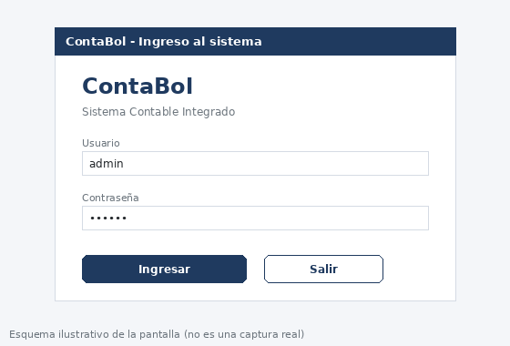{width=60%}

## Caso P3 ★ Ingreso y cambio de clave

**Pasos**

1. Usuario `admin`, contraseña `admin`. Pulse *Ingresar*.
2. El sistema obliga a cambiar la clave: escriba una nueva (mínimo 6 caracteres según validación) y confírmela.

**Resultado esperado:** se abre la ventana principal. Una clave débil o que no coincide es rechazada con mensaje claro.
**Prueba negativa:** cierre sesión (*Archivo > Cerrar sesión*), ingrese con clave errónea → "Usuario o contraseña incorrectos".

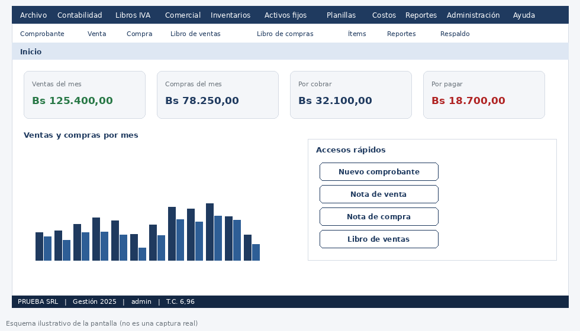{width=100%}

## Caso P4 ★ Crear la empresa de prueba

**Datos**

| Campo | Valor |
|---|---|
| Código | PRUEBA |
| Razón social | PRUEBA S.R.L. |
| NIT | 1020304050 |
| Dirección / ciudad | Av. Camacho 123, La Paz |
| Gestión (año) | el año en curso (ej. 2025) |
| Numeración | Correlativo mensual |

**Pasos:** *Archivo > Cambiar de empresa o gestión > Nueva empresa*, completar datos, aceptar, y abrir la empresa creada.

**Resultado esperado:** la barra inferior muestra "PRUEBA S.R.L. | Gestión 2025 | admin". Se crea el archivo `Datos\PRUEBA\2025.accdb` y se carga el plan de cuentas boliviano.

## Caso P5 Tipo de cambio y UFV

**Pasos:** *Contabilidad > Tipos de cambio y UFV*. Agregue:

| Fecha | Dólar (Bs) | UFV |
|---|---|---|
| 01/01 | 6,96 | 2,50000 |
| 31/03 | 6,96 | 2,52000 |
| 31/12 | 6,96 | 2,60000 |

**Resultado esperado:** los tres registros aparecen en la lista. Abra *Reportes > Centro de reportes > Tipos de cambio y UFV*: debe mostrar los mismos datos.

# 3. Contabilidad

## Caso C1 ★ Plan de cuentas

**Pasos**

1. *Contabilidad > Plan de cuentas*. Expanda el árbol: Activo, Pasivo, Patrimonio, Ingresos, Egresos.
2. Cree una cuenta nueva bajo *Gastos de administración*: código `5.1.1.99`, nombre "Gastos varios de prueba", tipo movimiento (Sí).
3. Intente eliminar una cuenta que ya tenga movimientos (más adelante) → debe rechazarlo.

**Resultado esperado:** la cuenta nueva aparece y puede usarse en comprobantes; el código duplicado es rechazado.

## Caso C2 ★ Comprobante de traspaso (asiento de apertura)

**Pasos**

1. *Contabilidad > Nuevo comprobante* (Ctrl+N).
2. Tipo *Traspaso*, fecha 01/01, glosa "Aporte inicial".
3. Línea 1: Caja moneda nacional, Debe 50.000,00. Línea 2: Capital social, Haber 50.000,00.
4. Guardar.

**Resultado esperado:** muestra "El comprobante cuadra"; al guardar recibe el **Nº 1** del mes. Aparece en *Contabilidad > Comprobantes*.

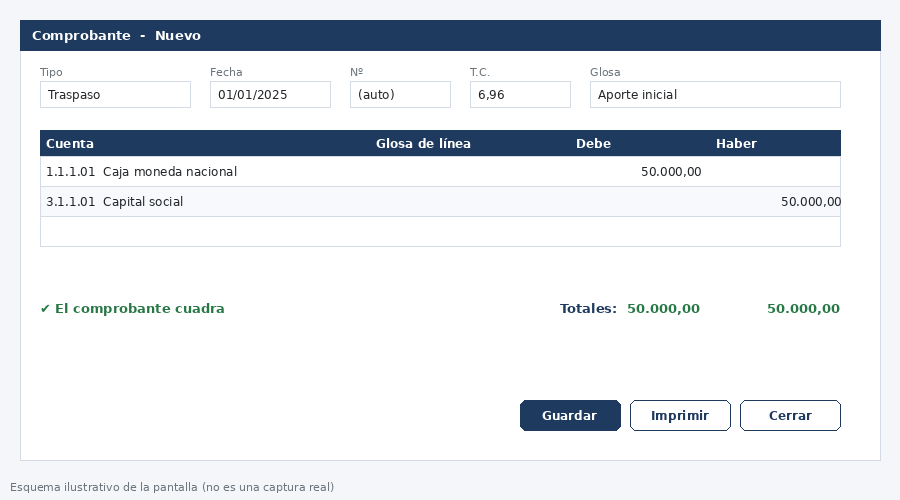{width=90%}

**Pruebas negativas**

| Intento | Resultado esperado |
|---|---|
| Debe 100 / Haber 90 | No deja guardar: comprobante descuadrado |
| Línea sin cuenta | Rechazo con mensaje |
| Fecha fuera de la gestión (año distinto) | Rechazo |
| Cuenta que no es de movimiento (grupo) | No se puede usar |

## Caso C3 Comprobante en dólares

**Datos:** egreso del 15/01 por 100 US$ a T.C. 6,96 de *Gastos de administración* contra Caja.

**Resultado esperado:** las columnas Bs muestran 696,00 y las de US$ 100,00; el comprobante cuadra en ambas monedas.

## Caso C4 Anular y consultar

**Pasos:** abra un comprobante del caso C3, pulse *Anular*, confirme.
**Resultado esperado:** queda marcado "Anulado"; sus importes ya no aparecen en el mayor ni en sumas y saldos; permanece en el listado (no se borra).

## Caso C5 ★ Libros y estados contables

Con los comprobantes de C2, C3 (sin anular uno nuevo) y las operaciones de los capítulos siguientes, genere:

1. *Reportes > Libro diario* (parámetros: del 01/01 al 31/12, moneda Bs).
2. *Reportes > Balance de sumas y saldos*.
3. *Reportes > Estado de resultados* y *Balance general*.
4. En cada ventana pulse **PDF** y **Excel**.

**Resultado esperado**

- Libro diario: comprobantes ordenados, con Debe/Haber y totales iguales.
- Sumas y saldos: **Total Debe = Total Haber** y Total saldo deudor = Total saldo acreedor.
- Balance general: **Activo = Pasivo + Patrimonio** (incluye resultado de la gestión).
- El PDF abre con encabezado de empresa/NIT y pie con número de página; el Excel abre con importes numéricos.

*Reporte real — Libro diario:*

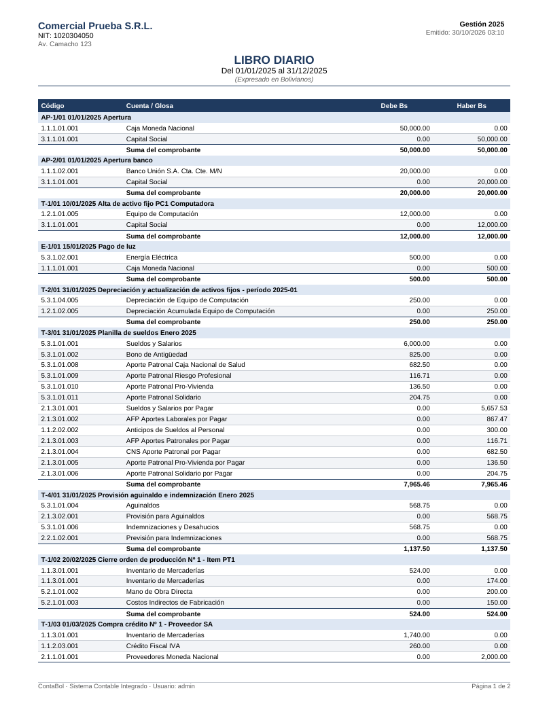{width=95%}

*Reporte real — Balance de sumas y saldos:*

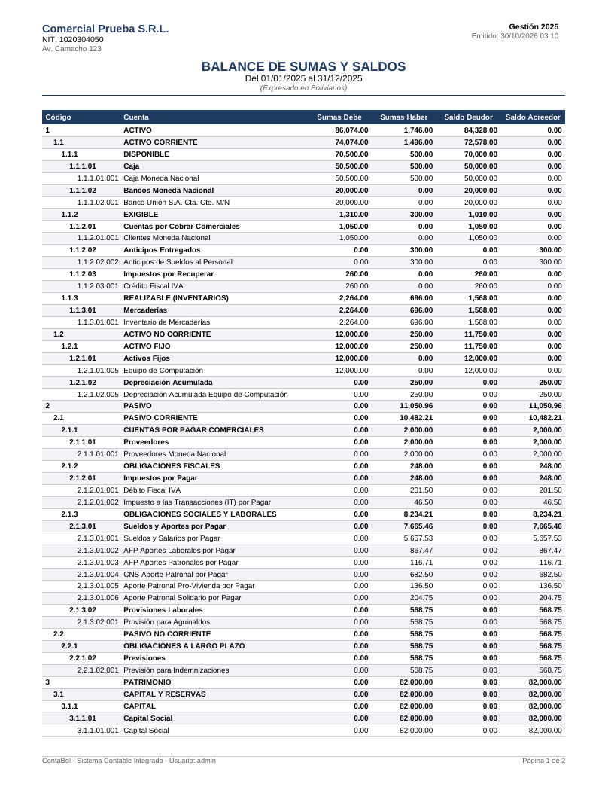{width=95%}

*Reporte real — Estado de resultados:*

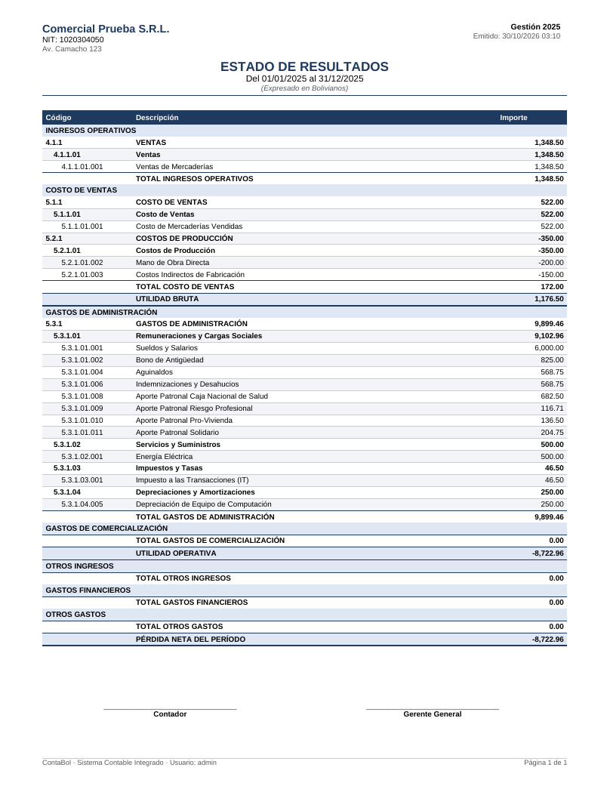{width=95%}

*Reporte real — Balance general:*

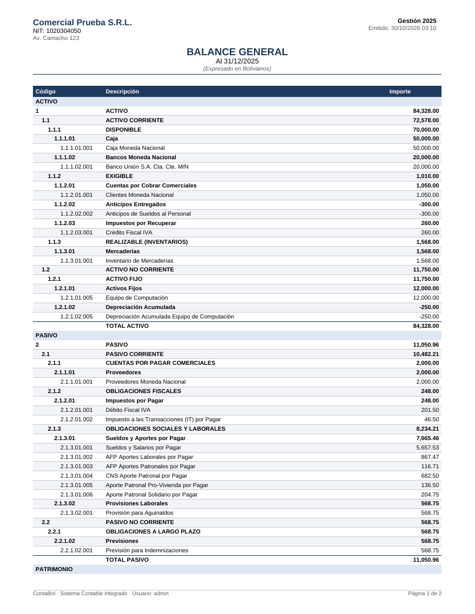{width=95%}

## Caso C6 Reimpresión de comprobante

*Contabilidad > Comprobantes*, seleccione uno, *Imprimir/PDF*. Debe mostrar cabecera, líneas, totales y espacios de firma (elaboró, revisó, aprobó).

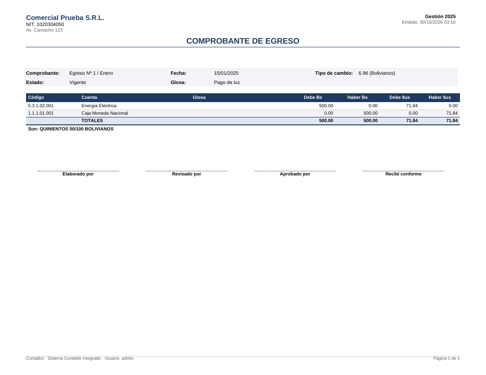{width=85%}

# 4. IVA e IT

## Caso I1 ★ Venta con factura (ejemplo del manual Orion)

**Datos:** venta al contado, factura Nº 1001, importe total **Bs 1.000,00**, cliente "CLIENTE UNO", NIT 1234567.

**Pasos:** *Libros IVA > Libro de ventas (registro)* → *Nueva* → completar → Guardar.

**Resultado esperado (asiento generado):**

| Cuenta | Debe | Haber |
|---|---|---|
| Caja | 1.000,00 | |
| IVA débito fiscal (13 %) | | 130,00 |
| Ventas | | 870,00 |
| Gasto IT (3 %) | 30,00 | |
| IT por pagar | | 30,00 |

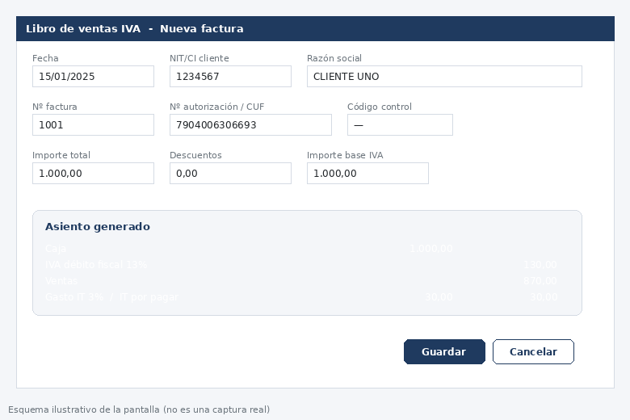{width=85%}

## Caso I2 ★ Compra con factura

**Datos:** compra al contado, factura Nº 5001 del proveedor NIT 7654321, total **Bs 500,00**.

**Resultado esperado:** Crédito fiscal IVA 65,00 (13 % de 500) y gasto/compra 435,00 contra Caja 500,00.

## Caso I3 ★ Libros y resumen mensual

**Pasos:** *Libros IVA > Libro de compras IVA*, *Libro de ventas IVA* y *Resumen mensual de IVA e IT* para el mes de las facturas.

**Resultado esperado**

- Cada libro lista las facturas con importe total, base, débito/crédito fiscal y totales.
- Resumen: Débito 130,00 − Crédito 65,00 = **IVA por pagar 65,00**; IT del mes 30,00.

*Reporte real — Libro de ventas IVA:*

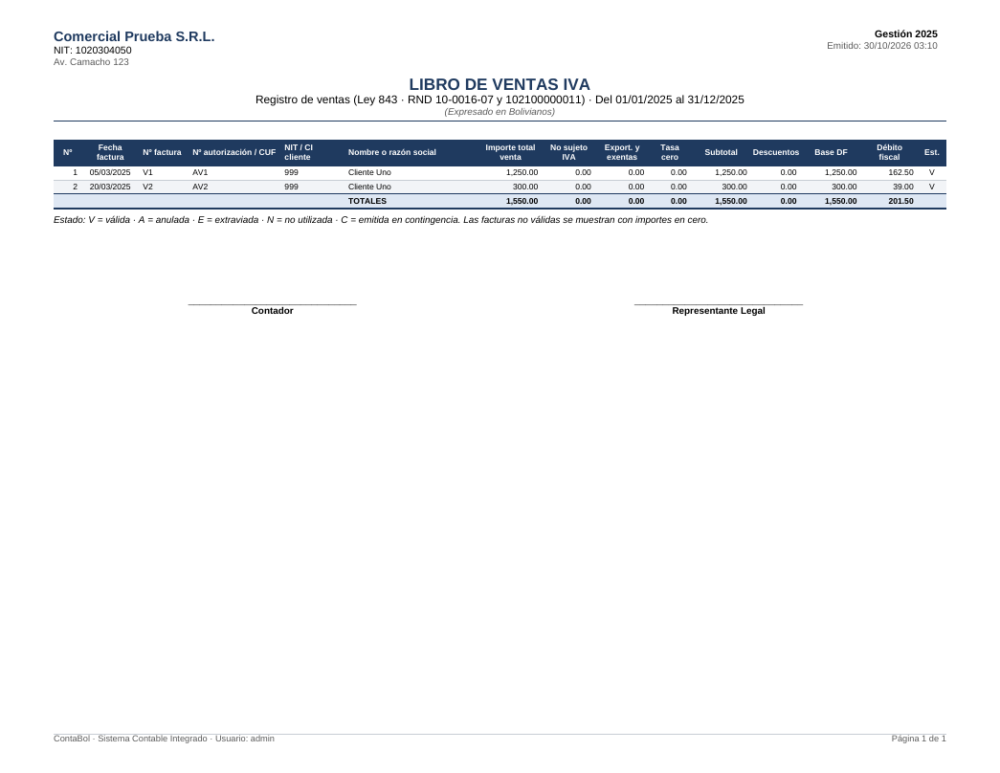{width=95%}

*Reporte real — Libro de compras IVA:*

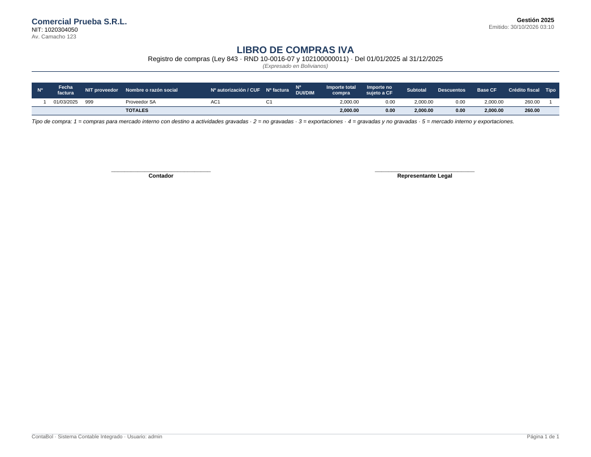{width=95%}

*Reporte real — Resumen mensual de IVA e IT:*

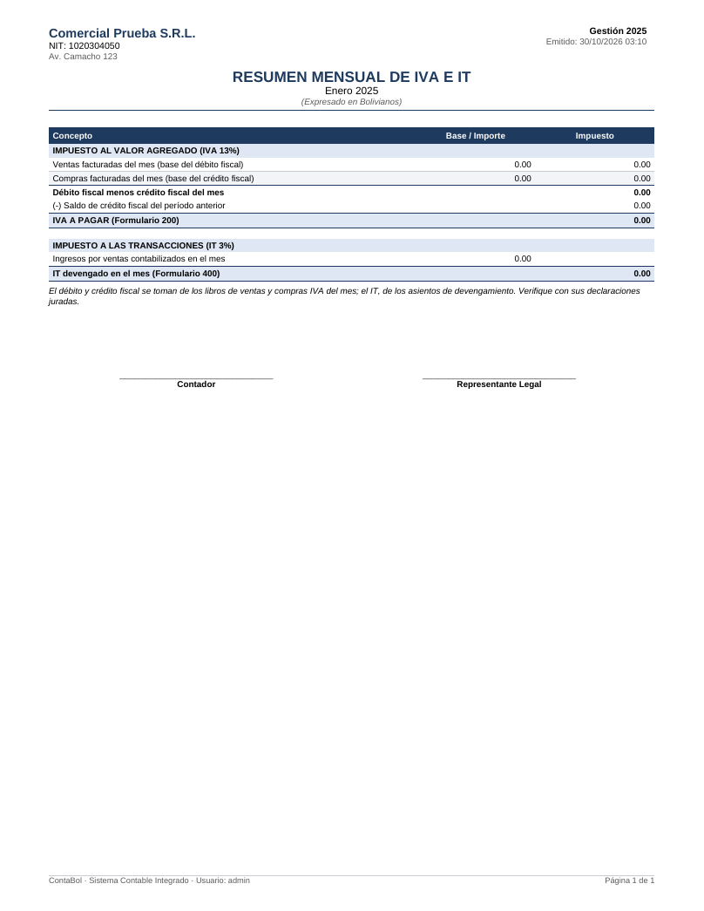{width=95%}

## Caso I4 Validaciones del libro

| Intento | Esperado |
|---|---|
| Repetir NIT + Nº de factura + autorización | Advertencia de duplicado |
| Factura **anulada** | Se registra con importes en cero y estado A |
| Fecha de otro mes distinto al del libro filtrado | Aparece en su propio mes |

# 5. Inventarios

## Caso V1 ★ Catálogos e ítem

1. *Inventarios > Tablas auxiliares > Almacenes*: crear `ALM1 - Almacén central`.
2. *Unidades de medida*: crear `UN - Unidad`.
3. *Inventarios > Ítems y precios*: crear ítem `A1 - Arroz 1 kg`, unidad UN, precio de venta 10,00, controla stock (Sí).

**Esperado:** ítem creado y visible en el listado con stock 0.

## Caso V2 ★ Stock inicial, compra, venta y costo promedio

| Paso | Operación | Cantidad | Costo/precio unit. | Existencias | Costo promedio |
|---|---|---|---|---|---|
| 1 | Stock inicial (*Ajustes, traspasos y stock inicial*) | 100 | 5,00 | 100 | 5,00 |
| 2 | Nota de compra (*Comercial > Nota de compra*) | 100 | 7,00 | 200 | **6,00** |
| 3 | Nota de venta (*Comercial > Nota de venta*) | 50 | 10,00 | 150 | 6,00 |

**Esperado:** costo de ventas del paso 3 = 50 × 6,00 = **300,00**; ingreso por ventas 500,00. En *Reportes > Kardex físico valorado* del ítem A1: tres líneas y saldo final **150 u / 900,00**.

*Reporte real — Kardex físico valorado:*

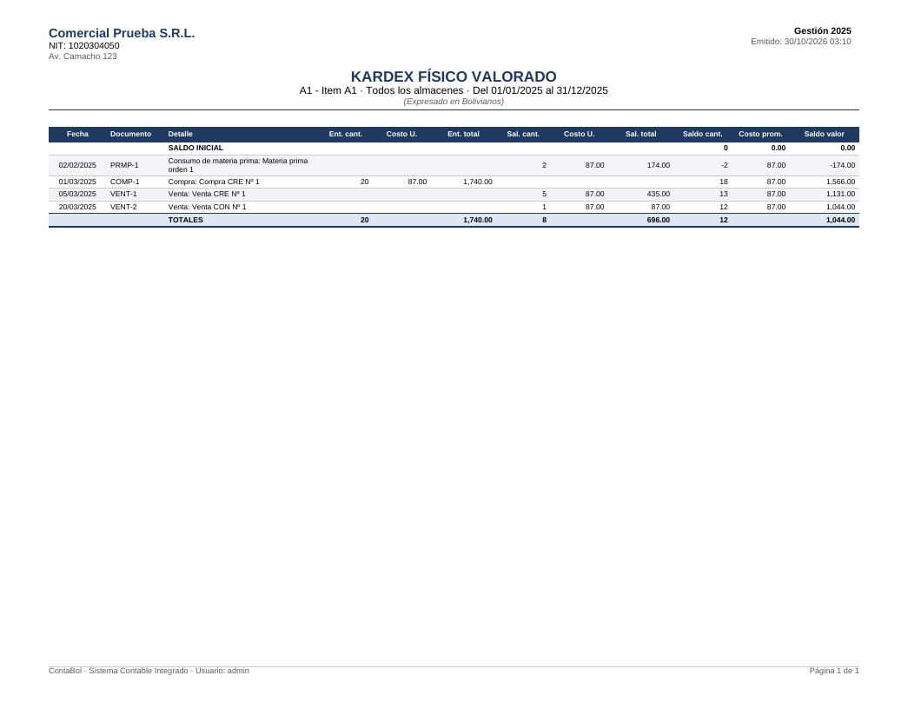{width=95%}

## Caso V3 Control de stock

Intente vender 500 u de A1. **Esperado:** advertencia o bloqueo de stock insuficiente (según el parámetro de la empresa) y no se descuenta nada si se cancela.

## Caso V4 Traspaso y ajuste

- Traspaso de 20 u de ALM1 a un segundo almacén ALM2: existencias totales no cambian; kardex por almacén muestra salida/ingreso.
- Ajuste de salida de 5 u por merma: existencias 145; se genera asiento a la cuenta de ajuste configurada.

## Caso V5 Vencimientos (FEFO)

Cree ítem con control de vencimiento y dos lotes (vence 30/06 y 31/03). Venda 1 unidad. **Esperado:** consume primero el lote que vence antes (31/03). *Productos vencidos y por vencer* lista ambos lotes con días restantes.

# 6. Comercial

## Caso M1 ★ Clientes, ventas a crédito y cobros

1. *Comercial > Clientes*: crear "CLIENTE UNO", NIT 1234567, límite de crédito 5.000.
2. *Nota de venta* a crédito: 10 u de A1 a 10,00 = 100,00 con factura.
3. *Cobros y pagos*: cobro parcial de 40,00 en efectivo.

**Esperado:** saldo del cliente 60,00. *Reportes > Saldos por cobrar* y *Kardex de cliente* muestran 100,00 de cargo, 40,00 de abono y saldo 60,00.

*Reporte real — Saldos por cobrar / por pagar:*

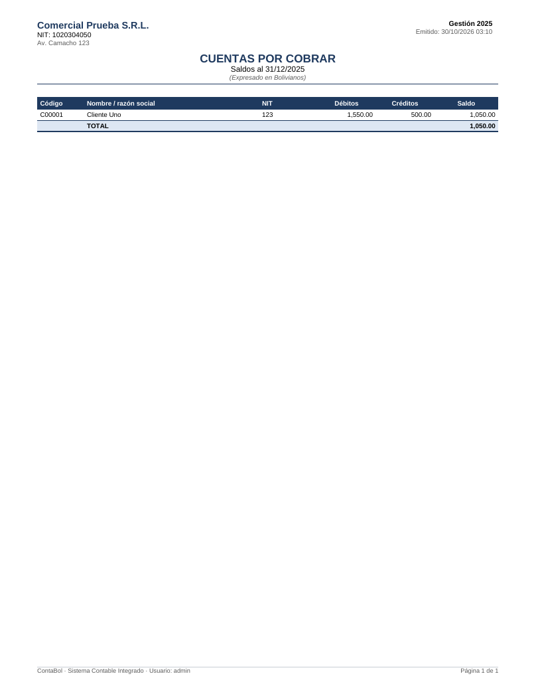{width=95%}

## Caso M2 Proveedores y pagos

Compra a crédito 500,00 a "PROVEEDOR SA"; pago de 500,00 → saldo 0 y la compra aparece como cancelada.

## Caso M3 Anulación de documentos

Anule la venta de M1 (si no tiene cobros) → se revierten stock, asiento y libro IVA; con cobros aplicados debe exigir anular el cobro antes.

## Caso M4 Impresión de notas

Imprima la nota de venta (PDF): número, cliente, ítems, subtotal, total en letras ("Cien 00/100 Bolivianos").

# 7. Activos fijos

## Caso A1 ★ Alta y depreciación

**Datos:** activo "Computadora", grupo *Equipo de computación* (vida útil 4 años, 25 %), fecha de alta 10/01, valor Bs 12.000,00.

**Pasos:** *Activos fijos > Registro de activos* (alta con contrapartida Capital o Caja); luego *Depreciación y actualización*: mes de enero, **Vista previa**, y **Registrar**.

**Esperado:** depreciación mensual = 12.000 × 25 % / 12 = **250,00**; se genera comprobante y la depreciación acumulada sube a 250,00. Sin registrar de nuevo no duplica.

*Reporte real — Cuadro de activos fijos:*

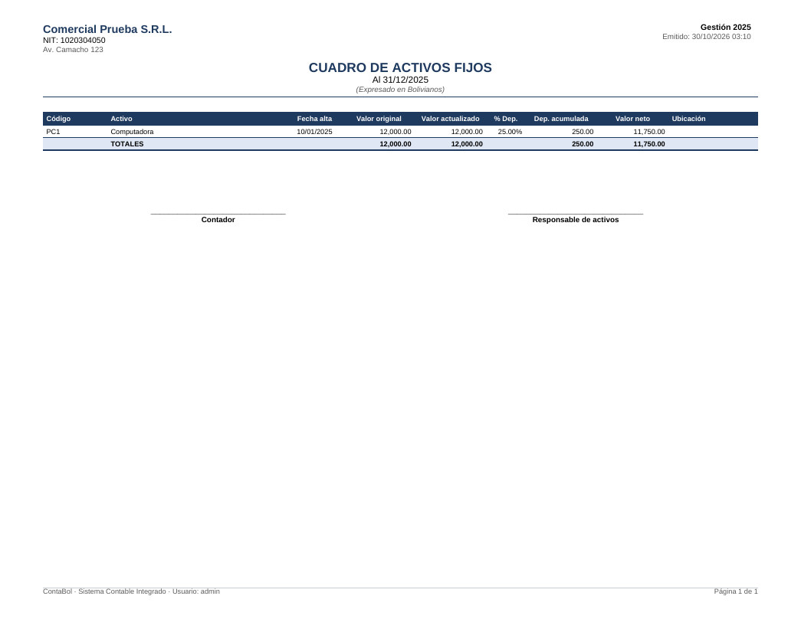{width=95%}

## Caso A2 Actualización por UFV

Con UFV al alta 2,50 y a diciembre 2,60, la actualización del valor es 12.000 × (2,60/2,50 − 1) = 480,00 (más la actualización de depreciación acumulada). Verifique que el reporte muestre valor actualizado y que, sin UFV cargada, el sistema avise.

# 8. Planillas

## Caso L1 ★ Empleado y planilla

**Datos:** empleado "ANA MAMANI", CI 111, ingreso 01/01/2020, haber básico Bs 6.000,00, cargo Contadora.

**Pasos:** *Planillas > Empleados* (alta) → *Planillas > Planilla de sueldos* → mes enero → Calcular → Cerrar (contabilizar).

**Esperado (parámetros por defecto, verifique contra la norma vigente)**

| Concepto | Valor esperado |
|---|---|
| Haber básico | 6.000,00 |
| Bono de antigüedad (5 años) | según escala de la ley (5 años = 5 % de 3 SMN) |
| Aporte laboral AFP (12,71 %) | ≈ 12,71 % del total ganado |
| Aportes patronales (≈16,71 %) | en *Resumen de aportes* |
| Líquido pagable | total ganado − descuentos − anticipos |

*Reporte real — Planilla de sueldos:*

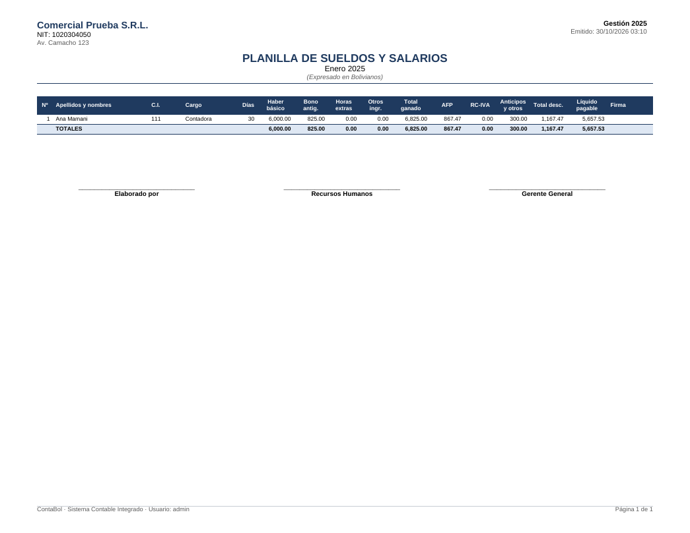{width=95%}

## Caso L2 Anticipos y boleta

Registre un anticipo de 300,00 el 15/01: aparece como descuento en la planilla del mes. Imprima la **Boleta de pago** (PDF) de ANA MAMANI: debe mostrar ingresos, descuentos y líquido.

# 9. Costos y producción

## Caso K1 ★ Orden de producción

**Datos:** producto terminado "PT1", cantidad 10.

1. *Costos > Órdenes de producción* → Nueva orden (almacén de materia prima y de producto terminado).
2. Consumo de materia prima: 2 u de A1 (costo promedio vigente).
3. Mano de obra: 8 horas del empleado.
4. CIF: "Energía eléctrica" 150,00.
5. Cerrar la orden con 10 u producidas.

**Esperado:** costo total = MP + MOD + CIF; costo unitario = total / 10. El PT1 ingresa al inventario por ese costo y la materia prima disminuye. Reporte *Hoja de costos* muestra los tres elementos.

*Reporte real — Hoja de costos:*

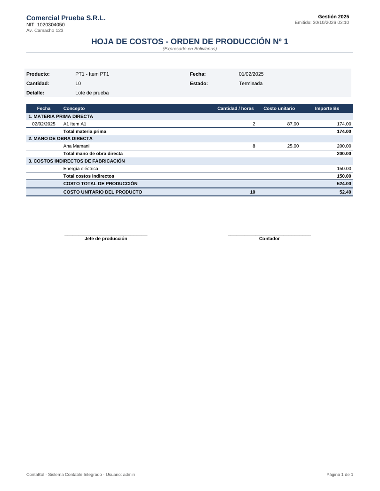{width=95%}

# 10. Bancos, centros de costo y presupuesto

## Caso B1 Conciliación bancaria
Registre un depósito y dos cheques; en *Contabilidad > Bancos > Conciliación bancaria* marque los movimientos que figuran en el extracto. **Esperado:** saldo según libros ± pendientes = saldo según banco, diferencia 0,00.

## Caso B2 Presupuesto
Asigne 600,00 mensuales a la cuenta de luz; contabilice 500,00 en enero. **Esperado:** *Ejecución presupuestaria* muestra 83,3 % ejecutado en enero.

## Caso B3 Centro de costo
Cree el centro "ADM – Administración", imputar un gasto y verificar *Gastos por centro de costo*.

# 11. Cierre y apertura de gestión

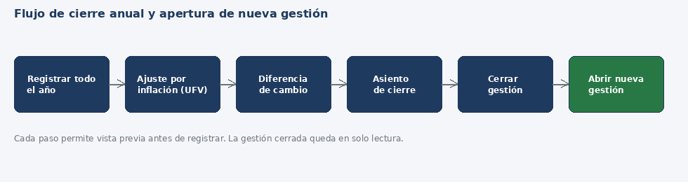{width=100%}

## Caso G1 ★ Ajustes y cierre

1. *Contabilidad > Cierre y ajustes de gestión*.
2. **Ajuste por inflación:** fecha 31/12 → *Vista previa* (revisar) → *Registrar*.
3. **Diferencia de cambio:** T.C. final distinto (ej. 6,96 → 6,96 sin diferencia; pruebe 7,00) → vista previa → registrar.
4. **Asiento de cierre:** *Generar asiento de cierre* → las cuentas de ingresos y egresos quedan con saldo 0 y el resultado pasa a *Resultado de la gestión*.
5. **Cerrar la gestión**.

**Esperado:** cada paso genera su comprobante. Con la gestión cerrada, intentar crear un comprobante o factura es rechazado; los reportes siguen funcionando.

## Caso G2 ★ Apertura de nueva gestión

*Cierre y ajustes > Abrir nueva gestión* (año siguiente). Acepte abrirla.

**Esperado**

- Existe `Datos\PRUEBA\<año+1>.accdb`.
- Hay asiento de apertura; el **balance de apertura cuadra** y coincide con el balance de cierre (el resultado pasa a resultados acumulados).
- Existencias iniciales igual a las finales (A1 con su costo promedio).
- Saldos de clientes y proveedores iguales al cierre.
- Activos fijos trasladados con su depreciación acumulada.

# 12. Multiempresa y consolidación

## Caso E1 ★ Aislamiento
Cree la empresa "FILIAL S.R.L.", registre un comprobante de 1.000,00. Cambie entre empresas con *Archivo > Cambiar de empresa o gestión*. **Esperado:** los datos de cada empresa son independientes (plan, comprobantes, terceros).

## Caso E2 Consolidación
*Contabilidad > Consolidación de empresas*: marque ambas gestiones, rango anual, nivel 5, moneda Bs. **Esperado:** el balance consolidado suma por código de cuenta; totales = suma manual de ambos balances.

# 13. Seguridad y auditoría

## Caso S1 ★ Roles y permisos
1. *Administración > Usuarios y permisos*: crear usuario `consulta` con rol *Consulta*.
2. Ingrese con ese usuario. **Esperado:** menús de registro (comprobantes, ventas, etc.) deshabilitados; sí puede ver reportes.

## Caso S2 Bloqueo por intentos
Cinco ingresos con clave errónea → usuario bloqueado; el administrador lo restablece desde *Usuarios*.

## Caso S3 Auditoría
*Administración > Auditoría del sistema*: aparecen ingresos, comprobantes creados y anulados con usuario, fecha y hora. Exporte a PDF y Excel.

# 14. Respaldo y recuperación

## Caso R1 ★ Respaldo y restauración
1. *Administración > Copias de seguridad* → respaldar la empresa PRUEBA (todas las gestiones). Se crea un `.cbk` en `Backups\`.
2. Registre un comprobante adicional (anote cuántos comprobantes hay).
3. Restaure el respaldo.

**Esperado:** tras restaurar, el comprobante adicional ya no existe; los demás datos permanecen.

## Caso R2 Integridad
Copie el `.cbk`, modifique un byte con un editor y trate de restaurar la copia. **Esperado:** rechaza el archivo por falla de verificación (SHA-256) sin tocar los datos.

## Caso R3 Respaldo automático
Cierre la aplicación: se genera un respaldo automático en `Backups\`.

# 15. Utilitarios y reportes

## Caso U1 Verificación
*Contabilidad > Utilitarios contables > Verificación y mantenimiento > Verificar contabilidad*. **Esperado:** lista con [OK] para comprobantes cuadrados, balance cuadrado, cuentas de parámetros existentes; [AVISO] si falta T.C./UFV; muestra tamaño del archivo.

## Caso U2 Cambio de cuenta y renumeración
Traslade movimientos de la cuenta "Gastos varios" a otra y verifique en el mayor; renumere comprobantes por fecha y verifique el orden.

## Caso U3 Compactar
*Utilitarios > Compactar base de datos*: la aplicación cierra las pestañas, compacta y reabre; el archivo no crece y los datos siguen.

## Caso U4 ★ Todos los reportes
Abra el *Centro de reportes* (F9). Para **cada módulo** pruebe al menos un reporte y verifique la lista de control:

| Control | ✔/✘ |
|---|---|
| Encabezado con razón social, NIT y período | |
| Totales correctos y coherentes con la pantalla | |
| Encabezado repetido en cada página y numeración "Página x de y" | |
| Importes alineados a la derecha con 2 decimales | |
| Excel: importes como número (se pueden sumar) y columnas legibles | |
| PDF y Excel muestran las mismas cifras | |
| Espacios de firma donde corresponde | |

## Caso U5 Importar desde Orion4 (si dispone de datos)
*Administración > Importar desde Orion4*: elija una carpeta de gestión Orion4, código de la empresa nueva y tipo de correlativo. **Esperado:** resumen de cuentas, comprobantes, terceros, ítems y facturas importados; compare el total de comprobantes y el balance de sumas y saldos contra Orion4. (Los movimientos de inventario no se migran: cargue *stock inicial*.)

# 16. Rendimiento y límites (opcional)
Con una gestión de 20.000 comprobantes de prueba: el listado de comprobantes abre en menos de 5 s, el mayor de una cuenta en menos de 10 s, y *Verificar contabilidad* informa el tamaño del archivo (Access admite 2 GB por archivo; por eso hay un archivo por empresa y gestión).

# Anexo A. Cómo capturar evidencia
1. Con la ventana activa pulse **Alt + ImprPant** (copia solo la ventana) y péguela en Word o en Paint.
2. También puede usar la herramienta *Recortes* de Windows (Win + Mayús + S).
3. Nombre cada captura con el caso: `C2_comprobante_guardado.png`.
4. Para errores, capture el **cuadro de error completo** (incluye la instrucción SQL) y adjunte el archivo de registro si existe en la carpeta de datos.

# Anexo B. Registro de resultados

| Caso | Fecha | Probador | Resultado (✔/✘/⛔) | Evidencia | Observaciones |
|---|---|---|---|---|---|
| P1 | | | | | |
| P2 | | | | | |
| P3 | | | | | |
| P4 | | | | | |
| P5 | | | | | |
| C1–C6 | | | | | |
| I1–I4 | | | | | |
| V1–V5 | | | | | |
| M1–M4 | | | | | |
| A1–A2 | | | | | |
| L1–L2 | | | | | |
| K1 | | | | | |
| B1–B3 | | | | | |
| G1–G2 | | | | | |
| E1–E2 | | | | | |
| S1–S3 | | | | | |
| R1–R3 | | | | | |
| U1–U5 | | | | | |

**Conclusión:** ☐ Aprobado ☐ Aprobado con observaciones ☐ Rechazado  Firma: ____________________  Fecha: __________
