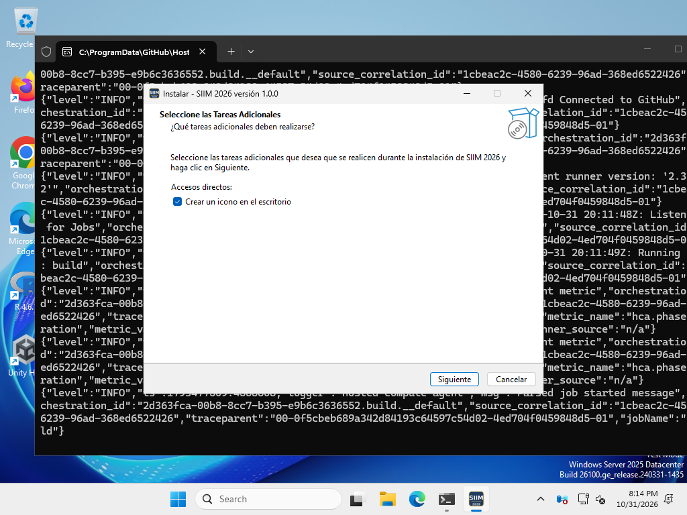
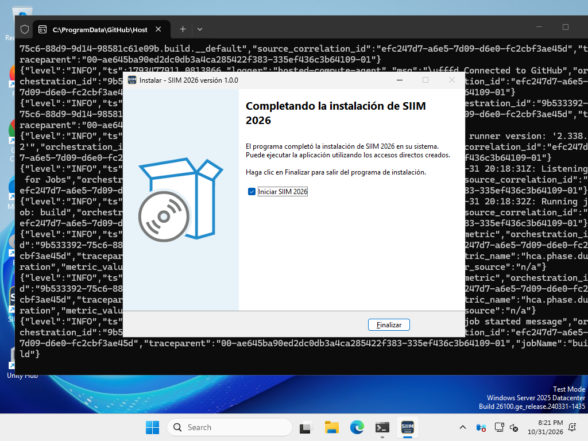
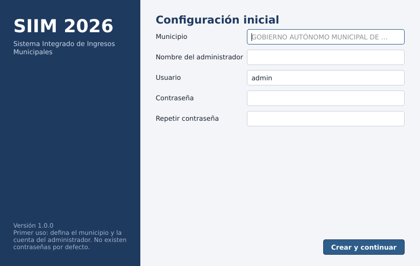
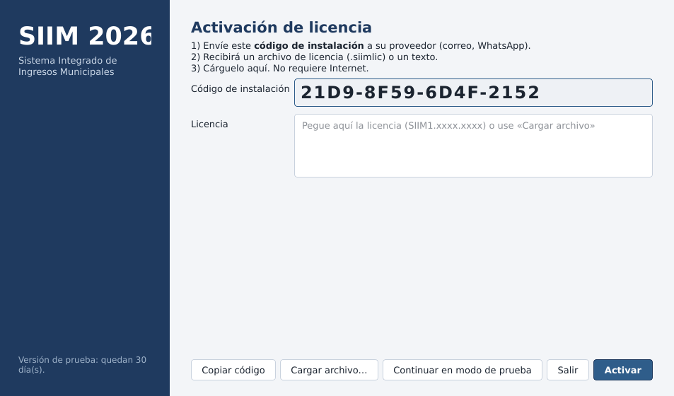
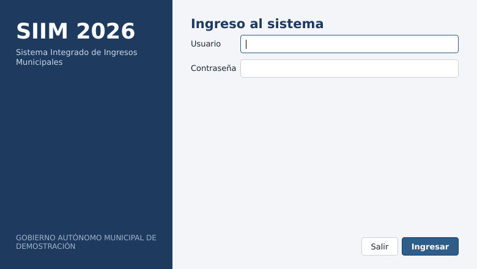
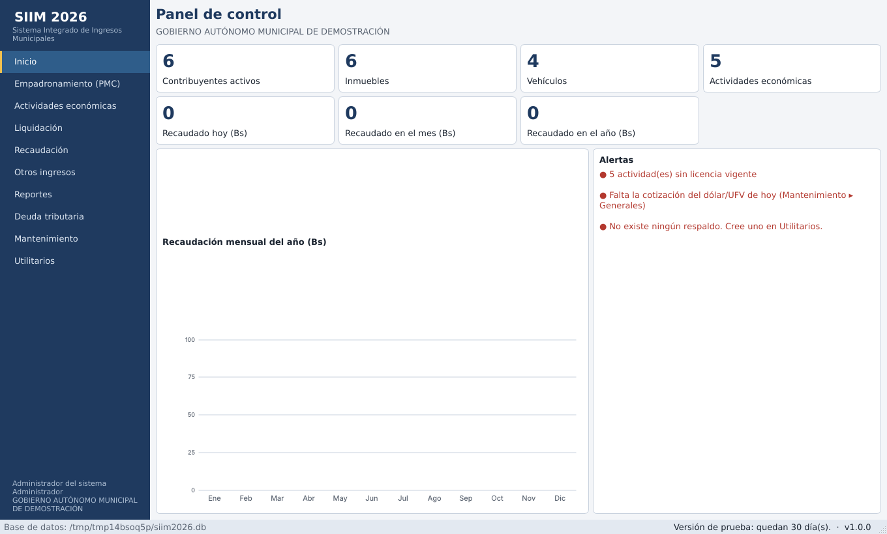

# 1. Introducción

**SIIM 2026** es la reconstrucción para Windows 10 y Windows 11 del *Sistema Integrado de Ingresos Municipales (SIIM)* desarrollado en 1998 por el Viceministerio de Planificación Estratégica y Participación Popular de Bolivia. El sistema original estaba escrito en Visual FoxPro 2.5 para Windows (aplicaciones `.APP` de 16 bits), tecnología que **no se ejecuta en Windows 11**. SIIM 2026 conserva la estructura, la lógica tributaria y los nombres de los módulos del SIIM — Empadronamiento (PMC), Liquidación, Recaudación, Otros Ingresos, Mantenimiento y Utilitarios — con un diseño más sobrio y una base técnica moderna, segura y estable.

Este manual está dirigido al **personal técnico y a los responsables tributarios** que implantarán el sistema en un Gobierno Autónomo Municipal (GAM). Se complementa con el *Manual de Pruebas y Capacitación* (ejercicios resueltos) y con el folleto informativo.

## 1.1 Qué se estudió para construirlo

| Fuente | Aporte al nuevo sistema |
|---|---|
| Guía de Implementación del SIIM | Marco normativo, instrumentos técnicos de IPBI, IPVA, IMT, ICE-Chicha, Patentes y Tasas; modelo de Ordenanza de Patentes (patente máxima × porcentaje zona-superficie); clasificador de recursos y estructura de *Otros Ingresos*; pasos de implementación |
| Manual de Usuario SIIM | Flujo completo de pantallas: formularios F-019/F-027/F-035, liquidación (F-1980, F-2160, F-501, F-502/503), recaudación en caja/banco, cuenta corriente, FUC, reportes, mantenimiento, utilitarios |
| Apuntes Tributarios SIIM – Cálculo de la Deuda Tributaria | Fórmulas de mantenimiento de valor, intereses, mora y multa por deberes formales para deudas anteriores y posteriores al 26/12/2002; ejemplos numéricos usados como pruebas automáticas |
| Archivo `wsiim98.rar` (sistema SIIM) | Estructura de directorios y tablas de datos (zonas, CIIU, escalas, depreciaciones, valores de vehículos 1991‑1999) y lista de formularios y reportes del sistema original |
| Investigación en la web | Normativa municipal vigente y mejoras (ver capítulo 3) |

# 2. Arquitectura y tecnología

| Aspecto | Decisión | Motivo |
|---|---|---|
| Lenguaje | Python 3.12 | Estable, mantenible y con librerías maduras de PDF, Excel y criptografía |
| Interfaz | PySide6 (Qt 6) | Aplicación nativa de escritorio, soporta Windows 10/11, tema formal propio |
| Base de datos | SQLite en modo WAL, `synchronous=FULL`, claves foráneas | Base transaccional con ACID: ante un corte de energía no se corrompen los datos; sin servidor que administrar |
| Reportes | reportlab (PDF) y openpyxl (Excel) | Todos los reportes y formularios salen en ambos formatos |
| Seguridad | PBKDF2‑SHA256 (600 000 iteraciones), roles, bloqueo por intentos, bitácora con cadena de hashes | Evidencia de manipulación y trazabilidad |
| Licencias | Firma digital Ed25519 ligada al equipo; herramienta externa del proveedor | Funciona sin Internet y se instala en varios equipos con licencias individuales |
| Respaldos | API de respaldo de SQLite + ZIP + SHA‑256 + cifrado AES opcional | Respaldo consistente con el sistema en uso, verificado al crearse |
| Instalador | PyInstaller + Inno Setup | Un único `SIIM2026_Setup_1.0.0.exe` |

> **Alcance de red.** SQLite está pensado para **un equipo por base de datos** (o varios usuarios de Windows en el mismo equipo). No se recomienda abrir el archivo de datos desde varias PCs por carpeta compartida: puede corromper la base. Si el municipio necesita varias estaciones de trabajo simultáneas, el diseño (capa de servicios separada de la interfaz) permite migrar a un servidor PostgreSQL; esa extensión no forma parte de esta versión.

## 2.1 Requisitos del equipo

- Windows 10 u 11 de 64 bits, 4 GB de RAM, 1 GB libres en disco (más el espacio de los respaldos).
- Impresora PDF o láser/inyección (los formularios se emiten en A4; ya no se requiere impresora matricial de carro largo).
- UPS o regulador de voltaje recomendado. Unidad USB o carpeta de red para la copia externa de respaldos.

## 2.2 Estructura de carpetas

```
C:\Program Files\SIIM2026\          Programa (se actualiza al reinstalar)
C:\ProgramData\SIIM2026\
    siim2026.db                     Base de datos (NO copiar con el sistema abierto: use Respaldos)
    backups\                        Copias de seguridad (.siimbak)
    reportes\                       PDF generados
```

La desinstalación **no borra** `C:\ProgramData\SIIM2026`. Para mover los datos a otra computadora use *Utilitarios ▸ Copias de seguridad* y restaure en el equipo nuevo.

# 3. Marco normativo vigente y mejoras incorporadas

## 3.1 Lo que cambió desde 1998

El SIIM se diseñó con la Ley 843, la Ley 1551 y la Ley de Municipalidades 2028. La revisión realizada para este proyecto encontró:

- **La Ley 2028 de Municipalidades figura como abrogada** ([Pixilegal](https://www.pixilegal.com/normativa/ley-2028-1999-10-28)). Su reemplazo, para el régimen de gobiernos autónomos municipales, es la **Ley 482 (2014)**. Por eso SIIM 2026 ya no habla de «aprobación por el Senado»: el campo *Base legal* del municipio (Mantenimiento ▸ Parámetros) se imprime en todos los formularios y debe citar **su propia ley municipal**.
- **La Ley 154 (2011)** clasifica los impuestos de dominio municipal y regula su creación; según el texto consultado, los gobiernos autónomos crean sus impuestos mediante **ley municipal** con informe técnico favorable de la Autoridad Fiscal (arts. 20 a 22) ([CEPB – Ley 154](https://normativa.cepb.org.bo/Normas/VerNorma/7567), [Lexivox](https://www.lexivox.org/norms/BO-L-N154.html)).
- **Las patentes las crea el Concejo Municipal por ley/ordenanza municipal** con base en la Ley 482; ejemplos recientes: [Ley Municipal 288/2020 de Colcapirhua](https://colcapirhua.gob.bo/pdf/leyes2020/Ley_municipal_288_2020.pdf) (patente de funcionamiento permanente y eventual; base según actividad, ubicación y superficie) y el [Reglamento 010/2025 a la Ley Municipal 248/22 de Sucre](https://gacetamunicipalsucre.gob.bo/docs/normas/reglamento/40256/RG.M.-010-2025-REGLAMENTO-A-LA-LEY-N-248-22-DE-CREACION-Y-ADMINISTRACION-DE-PATENTES-MUNICIPALES-DEL-G.A.M.S.-1740754242.pdf) (declaración jurada de actividad y formulario de inspección para expendio de alcohol).
- **Las escalas de IPBI e IPVA se actualizan cada gestión**. Un ejemplo de 2025 ([Sacaba](https://gaceta.sacaba.gob.bo/public-documents/ccaa20f3-5ea1-45b8-9855-ea7ef602242d/file)) actualiza la escala del IMPVAT con la variación de la UFV entre el 1 de enero y el cierre del año. SIIM 2026 permite cargar y **copiar a una nueva gestión** todas las tablas (botón *Copiar a otra gestión*).
- **Deuda tributaria**: el Art. 47 de la Ley 2492 y el DS 27310 siguen siendo la base (tasa activa en UFV + 3 puntos, mantenimiento de valor con la UFV) ([DS 27310](https://www.lexivox.org/norms/BO-DS-27310.html), [explicación](https://boliviaimpuestos.com/calcular-la-deuda-tributaria/)). Las facilidades de pago del Art. 55 se conceden por una sola vez; las condonaciones de la Ley 812 (2016) fueron temporales y **no** se aplican automáticamente.

> **Limitación declarada.** En la investigación no se encontraron publicadas, en fuentes oficiales accesibles, las tablas nacionales de IPBI/IPVA ni los vencimientos de las gestiones 2025‑2026. Por eso el sistema se entrega con las tablas de la **gestión 2004 de la Guía** (y las históricas 1991‑1999 del SIIM 98) **como ejemplos de capacitación**. Antes de operar, cada municipio debe cargar los valores de su Resolución/Ley Municipal vigente. Verifique siempre los textos oficiales; la ley municipal de su GAM prevalece.

## 3.2 Mejoras incorporadas al módulo de Actividades Económicas, Tasas y Patentes

| Mejora | Descripción | Dónde |
|---|---|---|
| Tres modalidades de cálculo de patente | Patente máxima × % zona‑superficie (ordenanza modelo), Patente Única Anual (valor/m² por zona) y monto fijo por categoría; el municipio elige | Parámetros ▸ Modalidad |
| Duodécimas automáticas | Patente proporcional a los meses de funcionamiento en la gestión (inicio o cese dentro del año) | Liquidación PAF |
| Factor de consumo eléctrico | Ponderación opcional por kWh/mes (variable que el SIIM registraba pero no usaba) | Tablas Patentes |
| Actualización por variación del dólar | Art. 22 de la ordenanza modelo (opcional) | Parámetros |
| Patente mínima | Piso configurable | Parámetros |
| Licencia de funcionamiento | Emisión/renovación con número correlativo, vigencia configurable, estados (vigente, vencida, suspendida, cancelada) y bloqueo si hay patentes vencidas impagas | Actividades ▸ Establecimientos |
| Licencia con QR verificable | Código de verificación firmado con un secreto local; cualquier persona puede comprobar su autenticidad en *Verificar licencia* | Licencia PDF |
| Clasificadores CIIU/CAEB | 275 códigos CIIU del SIIM 98 editables; vinculan cada establecimiento con su actividad CAEB/matrícula SEPREC | Actividades |
| Inspecciones y clausuras | Registro de inspecciones (conforme/observado/clausura) con plazo para subsanar | Actividades |
| Alertas | Licencias por vencer, actividades sin licencia, falta de cotización, planes impagos, antigüedad del respaldo | Panel de inicio |
| Simulador de patente | Compara las tres modalidades para un establecimiento real o hipotético; sirve para evaluar una nueva ordenanza | Actividades ▸ Simulador |
| Publicidad y propaganda | Padrón de anuncios y liquidación anual por m² y tipo (luminoso, simple, mural) | Padrón / Liquidación |
| Patentes eventuales y espectáculos | Sentajes, espectáculos, bailes, juegos: cobro por FUC con aranceles de la ordenanza | Otros ingresos |
| Código de pago único con dígito verificador | Cada liquidación imprime un código y un QR de uso bancario | Formularios |
| Conciliación bancaria | Carga el archivo del banco (Excel/CSV) y registra los pagos que cuadran con lo calculado | Recaudación |
| Facilidades de pago | Plan de cuotas (sistema francés), una sola vez por contribuyente, con cronograma e impresión | Liquidación ▸ Planes |
| Pagos digitales | El código de pago y el QR permiten usar canales digitales; el QR interbancario ya es el medio de pago más usado en el país ([BCB](https://www.lostiempos.com/actualidad/economia/20260614/banco-central-bolivia-resalta-uso-del-qr-28-veces-segundo-pais), [pasarela AGETIC](https://agetic.gob.bo/?p=2842)). Municipios como Cochabamba ya ofrecen oficina virtual por WhatsApp ([nota](https://ground.news/article/taxes-alcaldia-launches-new-version-of-the-forgive-with-virtual-office-via-whatsapp)); la integración directa con una pasarela queda como extensión futura |

## 3.3 Otras mejoras generales

- **Bitácora a prueba de manipulación** (cadena de hashes SHA‑256) y verificación en *Utilitarios ▸ Base de datos*.
- **Bajas lógicas**: nada se borra del padrón; la baja F‑035 conserva el historial.
- **Rectificatorias con crédito**: los pagos anteriores se descuentan automáticamente.
- **Estimación de evasión** en la cuenta corriente: gestiones vencidas sin liquidar se muestran como *NO LIQUIDADA* con la deuda calculada.
- **Alerta de cotización obsoleta**: si la última UFV/dólar cargada tiene más de 10 días el sistema se niega a calcular accesorios (evita cobros erróneos).
- **Importación de tablas** desde Excel/CSV y **copia de tablas** entre gestiones.
- **Selector de definición legal** de la multa por deberes formales (ver 7.3).

# 4. Instalación paso a paso

> **Qué descargar.** Vaya a la página de *Releases* del repositorio (etiqueta `siim2026-ultima-version`) y descargue **SIIM2026_Setup_1.0.0.exe** (instalador de un clic) o, si no desea instalar, **SIIM2026_Portable.zip**. Ambos se compilan y autoprueban automáticamente en Windows. **No ejecute nada de una carpeta llamada `build`**: son archivos temporales de compilación y producen el error «Failed to load Python DLL».

## 4.1 Instalación con el instalador (recomendada)

1. **Descargue** `SIIM2026_Setup_1.0.0.exe` y haga **doble clic**. Si Windows muestra «Windows protegió su PC» (el instalador aún no está firmado digitalmente), presione **Más información ▸ Ejecutar de todas formas**. Si pide permiso de administrador, presione **Sí**.
2. Aparece una única ventana del instalador: deje marcada la opción *Crear un icono en el escritorio* y presione **Siguiente/Instalar**. No hay que elegir carpetas ni idiomas.

{w=130}

3. Espere unos segundos a que se copien los archivos y presione **Finalizar** con la opción *Iniciar SIIM 2026* marcada.

{w=130}

4. **Primer uso**: el sistema pide el nombre del municipio y crea la cuenta del administrador (usuario, nombre y contraseña de 8 o más caracteres con letras y números). Anote la contraseña: no existe una predeterminada.

{w=130}

5. **Activación**: se muestra su *código de instalación*. Puede presionar **Continuar en modo de prueba** (30 días) o enviar el código a su proveedor para recibir la licencia (capítulo 5).

{w=130}

6. **Ingreso**: escriba su usuario y contraseña.

{w=120}

7. Aparece el **Panel de control**. Para practicar, un administrador puede cargar datos de demostración en *Utilitarios ▸ Base de datos* (sólo en una instalación vacía).

{w=150}

Después de instalar, abra el sistema desde el icono **SIIM 2026** del escritorio o del menú Inicio. Para **desinstalar** use *Configuración ▸ Aplicaciones*; los datos y respaldos de `C:\ProgramData\SIIM2026` se conservan.

## 4.2 Sin instalar (versión portable)

1. Descargue `SIIM2026_Portable.zip`. Clic derecho ▸ **Extraer todo…** a una carpeta, por ejemplo `C:\SIIM2026`. **No abra el .exe desde dentro del zip.**
2. Abra `SIIM2026.exe` (puede crear un acceso directo al escritorio). Continúe desde el paso 4 de la sección anterior.

## 4.3 Instalar en varias computadoras de escritorio

1. Copie el mismo `SIIM2026_Setup_1.0.0.exe` en un USB e instálelo en cada PC (pasos 1 a 3).
2. En **cada PC** el sistema muestra un código de instalación distinto: pida **una licencia por cada código** (capítulo 5).
3. Cada PC tiene su propia base de datos. Si necesita pasar los datos de una PC a otra, use *Utilitarios ▸ Copias de seguridad* (crear respaldo, copiar el archivo `.siimbak` a la otra PC y restaurarlo).

## 4.4 Solución de problemas de instalación

| Mensaje o síntoma | Causa | Solución |
|---|---|---|
| *Failed to load Python DLL … build\siim2026\_internal\python312.dll* | Se abrió el `.exe` de la carpeta temporal `build` | Use el instalador o `dist\SIIM2026\SIIM2026.exe`; nunca la carpeta `build` |
| El `.exe` abre y se cierra, o falta un archivo | Se ejecutó dentro del `.zip` sin extraer | Extraer todo y abrir desde la carpeta extraída |
| «Windows protegió su PC» | Instalador sin firma de código | Más información ▸ Ejecutar de todas formas (o firmar el instalador) |
| El antivirus bloquea o elimina el programa | Falso positivo por programa nuevo sin firma | Agregar la carpeta de instalación a las excepciones; solicitar la versión firmada |
| «No se puede escribir en la carpeta de datos» | Permisos de `C:\ProgramData\SIIM2026` | Ejecutar el instalador como administrador una vez |

## 4.5 Compilación del instalador (sólo para el proveedor)

El instalador se compila automáticamente en Windows con GitHub Actions cada vez que se actualiza el proyecto y se publica en *Releases*. Para compilar localmente: instale Python 3.12 (marcando *Add Python to PATH*) y, opcionalmente, [Inno Setup 6](https://jrsoftware.org/isinfo.php); cree su clave de licencias una vez con `python tools\licencias.py init`, y haga doble clic en `build_windows.bat`. Los archivos finales quedan en la carpeta `dist\`. Se recomienda firmar el instalador con un certificado de firma de código.

# 5. Activación y licenciamiento (método externo)

El municipio **nunca recibe la herramienta de licencias**. El proveedor conserva la clave privada.

```
CLIENTE                                              PROVEEDOR
1. SIIM > Activacion muestra el
   CODIGO DE INSTALACION 21D9-8F59-6D4F-2152  ---->  2. python licencias.py emitir
                                                        --codigo 21D9-8F59-6D4F-2152
                                                        --cliente "GAM Ejemplo" --dias 365
4. Cargar el archivo .siimlic (o pegar el      <----  3. Se genera licencia_GAM_Ejemplo_....siimlic
   texto de la licencia)
```

- El código se calcula a partir de la identidad de Windows (MachineGuid) y es distinto en cada PC. Una licencia **solo funciona en el equipo para el que se emitió**.
- Tipos: con vencimiento (`--dias 365`, `--vence 2027-12-31`), perpetua (`--perpetua`) o institucional (`--universal`, sin atar al equipo; úsela solo bajo contrato).
- La licencia está firmada con Ed25519: si se edita un solo carácter queda **inválida**. El programa solo contiene la clave pública.
- Si alguien retrasa el reloj de Windows para alargar la prueba o la licencia, el sistema lo detecta y pide corregir la fecha.
- El proveedor mantiene un registro (`~/.siim_vendor/registro.csv`) de todas las licencias emitidas.
- **Instalar en otra máquina**: el cliente envía su nuevo código y recibe una nueva licencia. Para trasladar los datos use un respaldo.

> **Importante para el proveedor:** respalde `~/.siim_vendor/license_private.pem` en un medio seguro. Si se pierde, deberá reemitir licencias a todos los clientes con una clave nueva y recompilar el instalador. Si se filtra, cualquiera puede fabricar licencias.

# 6. Puesta en marcha paso a paso

El orden sigue la Guía de Implementación del SIIM. Complete cada paso antes del siguiente.

## 6.1 Parámetros globales (Mantenimiento ▸ Parámetros)

| Parámetro | Qué indicar |
|---|---|
| Municipio, código INE, departamento, alcalde, responsable | Se imprimen en cabeceras y formularios |
| **Base legal** | Ley Municipal vigente de patentes y tasas, p. ej. «Ley Municipal Nº 123/2026» |
| Gestiones a liquidar | Rango que ofrecerán las pantallas; recuerde que las acciones de la Administración **prescriben a los 4 años** |
| Descuento por pago al contado | 10 % (IPBI, IPVA y patentes) salvo disposición distinta |
| Multa por deberes formales | 10 % del tributo omitido en UFV, mínimo 50 UFV (natural) o 240 UFV (jurídica), máximo 2 400 UFV |
| Modalidad de cálculo de patente | Según su ley municipal |
| Licencias | Vigencia en meses y días de alerta |
| Plan de pagos | Máximo de cuotas, tasa y % de cuota inicial |
| Cierre de sesión por inactividad | Minutos (por defecto 30) |

## 6.2 Datos globales (Mantenimiento ▸ Generales)

1. **Cotización del dólar y UFV**: cargue cada día los valores oficiales del BCB. Puede importar un archivo Excel/CSV con columnas `fecha, tipo_dia, dolar, ufv`. Marque los feriados (`FERIADO`) para el conteo de los 10 días hábiles del IMT.
2. **Tasa de interés (r)**: tasa activa promedio en UFV del BCB **más 3 puntos**, con su fecha de vigencia.
3. **Zonas y barrios**: según su zonificación aprobada.
4. **Fechas de vencimiento** por rubro y gestión: *contado* (con descuento), *1.ª y 2.ª cuota*, y *sin descuento ni accesorios hasta* (plazo de gracia; los accesorios corren desde el día siguiente).

## 6.3 Tablas del IPBI (Mantenimiento ▸ Tablas IPBI)

Fuentes: tablas de valuación zonal aprobadas por el Concejo y Resolución anual del Ministerio de Economía y Finanzas Públicas.

1. *Material en vías* por zona (valor Bs/m²) — de su valuación zonal.
2. *Calidad de construcción* para casas y departamentos (Bs/m²).
3. *Depreciación* por antigüedad.
4. *Escala impositiva* (cuota fija + % sobre el excedente).
5. *Factores* (inclinación, servicios, alícuota rural 0,20 %).

Cálculo: **Base imponible = terreno + construcción**; terreno = superficie × valor/m² × factor de inclinación × factor de servicios (mínimo 0,20 + 0,20 por cada servicio: luz, agua, alcantarillado, teléfono); construcción = m² × valor/m² × factor de depreciación; el impuesto se obtiene de la escala. Inmueble rural: 0,20 % del valor declarado. Benemérito de la Guerra del Chaco: exento hasta el tope del primer tramo.

## 6.4 Tablas del IPVA

Cargue de la Resolución anual: rangos de cilindrada (códigos 50‑57), valores por cilindrada y procedencia (7 procedencias), valores de motocicletas, depreciación por antigüedad, escala, y factores de chasis/carrocería para vehículos de más de 1,5 t. Ajustes automáticos: –15 % automóviles de dos puertas, +20 % turbo, +15 % doble tracción. Para personas jurídicas se usa el valor residual contable si se declara.

## 6.5 Tablas de Patentes (Mantenimiento ▸ Tablas Patentes)

Según la modalidad elegida:

- **Patente máxima × zona‑superficie**: cargue *Topes (PMA)* por actividad/categoría y la tabla *Zona–superficie* (% por rango de m²). `PF = PMA × PZS / 100`.
- **PUA**: cargue el valor por m² por zona; opcionalmente un tope por categoría.
- **Categoría**: cargue el monto fijo por categoría.
- Opcional: factor por consumo eléctrico y arancel de publicidad por m².

Ajuste la **estructura de actividades y categorías** a su ordenanza (Mantenimiento ▸ Actividades y rubros). El sistema trae el modelo de 15 actividades de la Guía.

## 6.6 Otros ingresos (Rubros y subniveles)

Estructura del clasificador: rubro maestro de 5 dígitos, subnivel de agregación de 2 y subnivel de entrada de 3 (p. ej. `15100` Tasas ▸ `151001.` Servicios técnicos ▸ `151001.001` Aprobación de planos). Defina **monto fijo o porcentaje** (no ambos) y el documento de respaldo. No cambie esta estructura a mitad de gestión. Se incluyen ejemplos de tasas, sentajes y espectáculos con los montos de la ordenanza modelo.

## 6.7 Usuarios y roles (Mantenimiento ▸ Usuarios)

{{PERMISOS}}

Buenas prácticas: una cuenta por persona; no compartir contraseñas; desactivar (no borrar) las cuentas de quien se retira; restablecer claves obliga a cambiarlas al ingresar.

## 6.8 Registro de contribuyentes

Registre en **Empadronamiento** a partir de las declaraciones juradas **F‑019** (altas), **F‑027** (modificaciones/incorporaciones) y **F‑035** (bajas). El PMC (8 dígitos desde 10 000 001) se asigna automáticamente. Un registro con datos mínimos pasa de *INCOMPLETO* a *ACTIVO* y habilita los botones de inmuebles, vehículos, actividades y publicidad. Para **migrar el padrón desde otro sistema** use *Utilitarios ▸ Importar padrón*: descargue la plantilla Excel (hojas contribuyentes, inmuebles, vehículos, actividades y publicidad), llénela, **valide** (simulación sin grabar, con lista de errores por fila) e importe; el sistema crea antes un respaldo.

# 7. Operación

## 7.1 Ciclo anual

1. **Enero**: cargar tablas, escalas y fechas de la nueva gestión (usar *Copiar a otra gestión* y actualizar valores). Ajustar el rango de gestiones.
2. Emitir liquidaciones individuales o masivas; imprimir formularios F‑1980, F‑2160 y F‑501.
3. Cobrar en caja o conciliar el archivo bancario. Diario: *Reportes ▸ Recaudación ▸ Recaudación diaria* por cajero y cierre de caja.
4. **Vencido el plazo**: *Liquidación masiva* para determinar la deuda de los contribuyentes en mora y emitir **intimaciones F‑345**.
5. **Mensual**: reporte SINCOM mayorizado por rubros para contabilidad.
6. **Anual**: licencias por renovar, comparativo anual y estadísticas.

## 7.2 Descuento y accesorios

- Pago al contado hasta la fecha *contado*: descuento (10 %).
- Hasta la fecha *sin descuento ni accesorios*: se paga el impuesto sin descuento.
- Después: **Deuda Tributaria** `DT = TO × (1 + r/360)ⁿ + M`, donde TO es el tributo omitido, r la tasa anual, n los días de mora (desde el día siguiente al vencimiento hasta el pago inclusive) y M la multa por deberes formales. Se desglosa en mantenimiento de valor, intereses y multa; se redondea a bolivianos enteros (configurable).

## 7.3 Nota sobre la multa por deberes formales

Los *Apuntes Tributarios SIIM* definen el tributo omitido en UFV como TO÷UFV, pero sus ejemplos numéricos lo calculan como TO×UFV. SIIM 2026 aplica por defecto la **definición legal (TO ÷ UFV)** y ofrece en Parámetros la opción «TO × UFV (como en los Apuntes)» para reproducir exactamente los ejemplos del documento. Además, en el Ejemplo 1 del documento el total de persona natural aparece como 1 662, pero la suma de sus propios componentes (1 194 + 515 + 121) es **1 830**; el sistema calcula 1 830. Se recomienda que la asesoría legal del municipio confirme el criterio a aplicar.

## 7.4 Transferencias (IMT)

3 % sobre el mayor entre el valor pagado y la base imponible de la última gestión vencida; pago en 10 días hábiles. El cambio de propietario del inmueble o vehículo en el padrón **se aplica solo cuando el impuesto se paga** (y se revierte si se anula el pago).

# 8. Seguridad y respaldos

## 8.1 Medidas de seguridad

- Contraseñas con hash PBKDF2‑SHA256; bloqueo de 15 minutos tras 5 intentos fallidos; cambio obligatorio de clave tras restablecerla.
- Cierre automático de sesión por inactividad.
- Permisos por rol aplicados en cada operación (no solo ocultando botones).
- Toda operación relevante queda en la **bitácora**, encadenada con hashes: la modificación o eliminación de un registro de bitácora se detecta.
- Operaciones atómicas: si algo falla a mitad de camino no queda información a medias.
- Licencia firmada y atada al equipo; detección de retroceso de reloj.
- **Recomendación**: habilitar el cifrado de disco (BitLocker) y restringir el acceso físico al equipo; la base de datos contiene datos personales de los contribuyentes.

## 8.2 Respaldos (Utilitarios ▸ Copias de seguridad)

- **Automático** cada 12 horas (configurable) y **al cerrar** el sistema. Se verifica la integridad y se relee el archivo creado.
- **Manual** con etiqueta y **contraseña opcional** (cifrado AES). *Guarde la contraseña: sin ella el respaldo no se puede abrir.*
- **Copia externa**: configure la carpeta de respaldo externo (USB/red) y el sistema copia cada respaldo.
- **Retención**: se conservan los últimos N respaldos y el más reciente de cada mes.
- **Restaurar**: el sistema crea antes un respaldo de seguridad (`antes-de-restaurar`), reemplaza los datos, verifica la integridad y, si algo falla, revierte automáticamente.
- Regla 3‑2‑1: 3 copias, 2 medios distintos, 1 fuera de la oficina. **Pruebe una restauración cada trimestre en otro equipo.**

## 8.3 Recuperación ante desastres

| Situación | Acción |
|---|---|
| Corte de luz con el sistema abierto | Reabrir. SQLite recupera sola la última transacción confirmada. Verificar en *Utilitarios ▸ Base de datos* |
| Mensaje de error de integridad al iniciar | No operar. Restaurar el último respaldo desde *Utilitarios* (o copiar el `.siimbak` a `backups\` en el equipo y restaurar) |
| Equipo dañado o robado | Instalar en un equipo nuevo, solicitar nueva licencia (nuevo código), restaurar el último respaldo externo |
| Error humano (liquidación equivocada) | Anular pago / rectificar liquidación; si es grave, restaurar un respaldo anterior |

# 9. Solución de problemas

| Síntoma | Causa probable | Solución |
|---|---|---|
| «No hay cotización de dólar/UFV…» | No se cargó la UFV del día | Mantenimiento ▸ Generales ▸ Dólar y UFV |
| «Falta valor de Material en vías…» | La tabla de la gestión no tiene la zona/material | Cargar la tabla en Tablas IPBI |
| «No están cargadas las fechas de vencimiento…» | Falta el registro del rubro y gestión | Mantenimiento ▸ Vencimientos |
| Contribuyente *INCOMPLETO* | Faltan documento, nombre/razón social o dirección | Completar con F‑027 |
| No se puede emitir licencia | Patentes vencidas sin pagar | Cobrar o autorización del supervisor |
| Windows muestra aviso de SmartScreen | Instalador sin firma | Firmar con certificado de código o «Más información ▸ Ejecutar» |
| La licencia «es de otro equipo» | Se instaló en una PC distinta | Solicitar nueva licencia con el código de esta PC |

# 10. Anexos

## 10.1 Equivalencia de menús SIIM 98 ▸ SIIM 2026

| SIIM 98 (FoxPro) | SIIM 2026 |
|---|---|
| Módulos SIIM ▸ Empadronamiento ▸ Nuevas incorporaciones F‑019 / Modificar F‑027 / Desincorporar F‑035 | Empadronamiento (PMC) ▸ botones F‑019, F‑027, F‑035 |
| Empadronamiento ▸ Control, Reportes y consultas, Estadísticas | Reportes ▸ Empadronamiento |
| Liquidación ▸ Inmuebles / Vehículos / Actividades | Liquidación ▸ Liquidación individual |
| Liquidación ▸ Liquidar gestiones | Liquidación ▸ Liquidación masiva |
| Transferencias IMT | Liquidación ▸ Transferencias (IMT) |
| Recaudación ▸ Registrar pagos (cajas/bancos/mixta) | Recaudación ▸ Registrar pago |
| Recaudación ▸ Listados, mensual y anual, periodos fiscales, SINCOM, cuenta corriente | Reportes ▸ Recaudación |
| Otros ingresos ▸ FUC, Control de transacciones, Reporte de formularios, Recaudaciones, Otros reportes | Otros ingresos y Reportes ▸ Otros ingresos |
| Mantenimiento ▸ Cotización del dólar (Ctrl‑D), Parámetros globales, Fechas de vencimiento, Información base | Mantenimiento ▸ Generales / Tablas IPBI / IPVA / Patentes |
| Mantenimiento ▸ Modificar registros incompletos (Alt‑M) | Padrón ▸ F‑027 (reporte *Registros incompletos*) |
| Utilitarios ▸ Reorganizar índices, Compactar, Copias de seguridad (disquete), Restaurar | Utilitarios ▸ Base de datos / Copias de seguridad |
| Importar información SIMAT | Utilitarios ▸ Importar padrón (Excel) y Mantenimiento ▸ Importar CSV/Excel |
| Teclas F2/F3/F4 (inmuebles/vehículos/actividades), F6 (multiacceso), F10 (guardar) | Pestañas del contribuyente, botón *Buscar (F6)*, botón *Guardar (F10)* |

## 10.2 Catálogo de reportes

Todos los reportes se pueden ver en pantalla, imprimir en PDF y exportar a Excel con totales.

{{REPORTES}}

## 10.3 Formularios y documentos en PDF

F‑1980 (IPBI), F‑2160 (IPVA), F‑501 (Patente), F‑501P (Publicidad), F‑502/503 (IMT), Boleta resumen (preliquidación), Recibo oficial de pago, Intimación F‑345, Formulario Único de Caja, Licencia de funcionamiento con QR, Kardex del contribuyente, Plan de pagos, Certificado de solvencia municipal y Hoja de cálculo de la deuda tributaria.

## 10.4 Tablas editables de Mantenimiento

{{TABLAS}}
